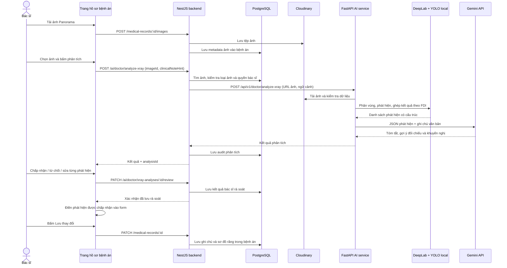

# Chức năng phân tích ảnh AI trong hồ sơ bệnh án bác sĩ

Trang liên quan: `http://localhost:3002/doctor/medical-records`.

Tài liệu mô tả mã nguồn trong working tree tại ngày **08/11/2026**, bao gồm các thay đổi chưa commit. Đây là kết quả đọc mã nguồn; chưa đăng nhập trang, chạy inference thực tế hoặc gửi ảnh bệnh nhân để kiểm thử. Các giá trị cấu hình bên dưới là mặc định trong code, không phải xác nhận cấu hình của tiến trình đang chạy.

## 1. Chức năng hiện tại làm gì?

Chức năng hỗ trợ bác sĩ đọc **phim X-quang toàn cảnh Panorama** đã lưu trong bệnh án. Hệ thống kết hợp ba phần:

| Thành phần | Công việc thực tế |
| --- | --- |
| DeepLab | Phân vùng ảnh theo vị trí 32 răng vĩnh viễn để biết một vùng thuộc răng nào. |
| YOLO | Phát hiện đối tượng răng và các dấu hiệu trên phim, trả mask, bounding box và điểm phát hiện. |
| Gemini | Nhận danh sách phát hiện và ghi chú lâm sàng dưới dạng văn bản, tạo tóm tắt và lời giải thích. |

YOLO và DeepLab chạy trong máy/môi trường triển khai `ai-service`. Gemini được gọi qua API bên ngoài. Trong luồng này, **Gemini không nhận ảnh**; dữ liệu gửi cho Gemini là JSON các phát hiện và ghi chú của bác sĩ. Các phát hiện có cấu trúc vẫn được lấy từ model local, không được thay bằng nội dung Gemini sinh ra. Nguồn: [pipeline ảnh](../apps/ai-service/app/services/vision_service.py), [wrapper model local](../apps/ai-service/app/services/local_panoramic_model.py), [Gemini client](../apps/ai-service/app/core/llm.py).

## 2. Sơ đồ luồng từ giao diện đến bệnh án



Đường dẫn NestJS trong sơ đồ là đường dẫn mà frontend truyền cho `apiClient`. Client ghép base URL `${NEXT_PUBLIC_API_URL || "http://localhost:3000"}/api/v1/admin`; vì vậy request phân tích thường đến `/api/v1/admin/ai/doctor/analyze-xray`. Luồng này đi qua backend, không dùng `NEXT_PUBLIC_AI_SERVICE_URL` để trình duyệt gọi AI service trực tiếp. Nguồn: [API client frontend](../apps/frontend-admin-receptionist-doctor/src/lib/api/client.ts), [analyzer](../apps/frontend-admin-receptionist-doctor/src/components/doctor/dental-xray-analyzer.tsx), [backend AI controller](../apps/backend/src/modules/ai/ai.controller.ts).

## 3. Chọn và lưu ảnh trước khi phân tích

Ở trang bệnh án, `DentalXrayAnalyzer` chỉ xuất hiện khi danh sách ảnh có ít nhất một ảnh đủ `id`, `url`, `type: "xray"` và `modality: "PANORAMIC"`. Danh sách ảnh đưa vào analyzer cũng lọc theo điều kiện này. Nút thêm/đổi ảnh mở phần quản lý ảnh của bệnh án. Nguồn: [trang medical-records](../apps/frontend-admin-receptionist-doctor/src/app/(dashboard)/doctor/medical-records/page.tsx).

Luồng tải ảnh hiện tại:

1. Giao diện nhận JPG, PNG hoặc WEBP, tối đa **3 MB/tệp**, tối đa 20 ảnh trong bệnh án.
2. Gửi multipart đến `POST /medical-records/:medicalRecordId/images`, kèm `type=xray`, `modality=PANORAMIC` và chú thích nếu có.
3. Backend kiểm tra tệp, lưu ảnh vào Cloudinary trong thư mục `smart-dental/medical-records`, tạo UUID cho ảnh, rồi lưu metadata vào trường JSON `MedicalRecord.images` và ghi lịch sử thay đổi bệnh án.

Như vậy, ảnh được lưu trước khi phân tích. Phân loại `PANORAMIC` trong luồng upload này được gán bởi ứng dụng; bước đó không chứng minh ảnh thực sự là Panorama. AI service còn thực hiện các kiểm tra ảnh riêng phía sau. Nguồn: [MedicalRecordImages](../apps/frontend-admin-receptionist-doctor/src/app/(dashboard)/doctor/medical-records/_components/MedicalRecordImages.tsx), [medical-record controller](../apps/backend/src/modules/medical-record/medical-record.controller.ts), [medical-record service](../apps/backend/src/modules/medical-record/medical-record.service.ts).

Khi bấm phân tích, frontend chỉ gửi:

```json
{
  "imageId": "UUID-cua-anh-da-luu",
  "clinicalNoteHint": "Lý do khám và chẩn đoán hiện có trong form"
}
```

`clinicalNoteHint` được ghép từ `chiefComplaint` và `diagnosis` hiện tại trong form, nên có thể chứa thay đổi chưa lưu. DTO backend giới hạn ghi chú này ở 2.000 ký tự. Backend tự tìm URL, bệnh nhân và bệnh án từ `imageId`, không lấy URL ảnh do trình duyệt tự khai báo. Nguồn: [trang bệnh án](../apps/frontend-admin-receptionist-doctor/src/app/(dashboard)/doctor/medical-records/page.tsx), [analyzer](../apps/frontend-admin-receptionist-doctor/src/components/doctor/dental-xray-analyzer.tsx), [DTO](../apps/backend/src/modules/ai/dto/doctor-ai.dto.ts), [AiService](../apps/backend/src/modules/ai/ai.service.ts).

## 4. Backend kiểm tra và chuyển tiếp thế nào?

API dùng JWT và kiểm tra vai trò `DOCTOR` hoặc `ADMIN`. Trình duyệt gửi Bearer token qua `apiClient`. Trước khi gọi Python, backend tìm ảnh trong JSON `medical_records.images`, kiểm tra ảnh tồn tại, có `type=xray`, `modality=PANORAMIC`; bác sĩ thông thường phải là bác sĩ gắn với bệnh án. Admin được bỏ qua kiểm tra sở hữu này. Nguồn: [AI controller](../apps/backend/src/modules/ai/ai.controller.ts), [resolveStoredXray](../apps/backend/src/modules/ai/ai.service.ts), [API client](../apps/frontend-admin-receptionist-doctor/src/lib/api/client.ts).

Request phân tích đi qua bộ giới hạn **5 yêu cầu AI/phút/tài khoản**, dùng bộ đếm trong bộ nhớ của backend; các chức năng AI khác dùng cùng bộ giới hạn có thể tiêu thụ lượt này. Sau đó backend gửi đến FastAPI:

```json
{
  "image_url": "URL-anh-da-luu",
  "image_base64": null,
  "patient_id": "UUID-benh-nhan",
  "clinical_note_hint": "Ghi chú lâm sàng"
}
```

Backend lấy địa chỉ từ `AI_SERVICE_URL`, gửi header `x-api-key` theo `AI_SERVICE_API_KEY`; FastAPI kiểm tra key này. Timeout mặc định của backend khi gọi AI service là 90 giây, có thể đổi bằng `AI_SERVICE_TIMEOUT_MS`. Nguồn: [AiService](../apps/backend/src/modules/ai/ai.service.ts), [rate limit](../apps/backend/src/modules/ai/ai-rate-limit.service.ts), [AiClientService](../apps/backend/src/modules/ai/ai-client.service.ts), [FastAPI doctor routes](../apps/ai-service/app/api/routes/doctor_assist.py).

## 5. AI service kiểm tra ảnh đầu vào

FastAPI chuyển request đến `PanoramicVisionService.analyze_xray_hybrid()`. Luồng web này tải ảnh từ URL; schema Python còn hỗ trợ base64 nhưng frontend không sử dụng khả năng đó cho request phân tích hiện tại. Nguồn: [doctor assist service](../apps/ai-service/app/services/doctor_assist_service.py), [schema](../apps/ai-service/app/schemas/doctor_assist.py), [vision service](../apps/ai-service/app/services/vision_service.py).

Các kiểm tra chính trong vision service:

| Kiểm tra | Cách thực hiện trong code |
| --- | --- |
| Nguồn URL | Chỉ HTTP/HTTPS, kiểm tra hostname theo `VISION_ALLOWED_IMAGE_HOSTS` (mặc định `res.cloudinary.com`), từ chối địa chỉ mạng không public, kiểm tra lại khi redirect. |
| Dung lượng xử lý | Tối đa 10 MB ở AI service, tối đa 25 triệu pixel; đây là giới hạn xử lý Python, khác giới hạn upload 3 MB của giao diện/backend. |
| Khả năng đọc ảnh | Kiểm tra nội dung trả về là ảnh, mở và xác minh tệp bằng Pillow. |
| Kích thước tối thiểu | Rộng ít nhất 256 pixel, cao ít nhất 128 pixel. |
| Loại ảnh | Dùng từ khóa trong URL, tỷ lệ pixel có màu, độ lệch sắc độ, độ tương phản và dải sáng để loại một số ảnh giao diện/tài liệu/ảnh không phù hợp; cho phép tông xanh đồng nhất theo điều kiện riêng. |
| Có cấu trúc răng | Sau khi chạy model, phải có ít nhất một instance tên bắt đầu bằng `TOOTH` với score từ 0,25 trở lên. |

Các phép kiểm màu và cấu trúc trên là quy tắc trong phần mềm. Việc vượt qua chúng không tự chứng minh chất lượng phim hoặc tính hợp lệ lâm sàng. Nguồn: [vision service](../apps/ai-service/app/services/vision_service.py), [local panoramic model](../apps/ai-service/app/services/local_panoramic_model.py).

## 6. YOLO và DeepLab thực sự phối hợp ra sao?

### 6.1. Nạp model và chạy dự đoán

Wrapper nạp code từ `dental-pano-ai/main.py`, đọc hai trọng số `models/deeplab/model.pth` và `models/yolo/model.pt` ở lần phân tích đầu tiên rồi tái sử dụng trong bộ nhớ. Khóa nạp bảo vệ khởi tạo; khóa inference cho chạy model lần lượt trong một instance wrapper. Phần inference được đưa sang thread bằng `asyncio.to_thread`. Nguồn: [local wrapper](../apps/ai-service/app/services/local_panoramic_model.py), [vision service](../apps/ai-service/app/services/vision_service.py).

DeepLab dùng semantic segmentation, cấu hình `DeepLabV3PlusHead`, backbone ResNet-101 và **33 lớp**: nền cùng 32 vị trí răng. YOLO dùng instance segmentation, cấu hình gốc `yolov8m-seg.pt`, trả đối tượng, mask và bounding box. Khi inference, code ghi đè mode thành `predict` và dùng trọng số local. Cả hai module mặc định chạy **CPU**; wrapper hiện tại không truyền tùy chọn GPU. Nguồn: [model implementation](../apps/ai-service/dental-pano-ai/main.py), [DeepLab config](../apps/ai-service/dental-pano-ai/models/deeplab/config.yaml), [YOLO config](../apps/ai-service/dental-pano-ai/models/yolo/config.yaml).

### 6.2. Ghép phát hiện vào số răng FDI

Post-processing lấy vùng mask của mỗi đối tượng YOLO, đối chiếu xác suất phân vùng DeepLab trong vùng đó để tính tỷ trọng thuộc từng răng. Với các dấu hiệu thông thường, điểm theo răng được tính từ `instance.score × tỷ trọng thuộc răng`, có xử lý chồng lấn mask; nhiều đóng góp cho cùng loại phát hiện/răng được gộp bằng `1 - tích(1 - điểm)`.

Riêng **răng mất**, code lấy các instance `TOOTH`, giảm trùng bằng NMS, tính điểm hiện diện theo răng rồi lấy `1 - điểm hiện diện`. Đây là kết quả suy ra từ mức hiện diện răng trong pipeline; không phải một đối tượng “răng mất” được YOLO nhìn thấy trực tiếp.

Chỉ số răng 1–32 được đổi sang FDI bằng cách chia bốn góc hàm, mỗi góc tám răng. Wrapper chỉ giữ entry có score **≥ 0,5**, làm tròn confidence bốn chữ số thập phân và gán `severity="UNASSESSED"`. Confidence là điểm tính toán của pipeline; code không chứng minh nó là xác suất chẩn đoán đã được hiệu chỉnh. Nguồn: [PostProcessingModule và FindingEntry](../apps/ai-service/dental-pano-ai/main.py), [analyze và _convert_entry](../apps/ai-service/app/services/local_panoramic_model.py).

### 6.3. Các loại phát hiện hiện có

| Nhãn trả về | Ý nghĩa hiển thị |
| --- | --- |
| `Missing tooth` | Răng mất |
| `Implant` | Implant |
| `Residual root` | Chân răng sót |
| `Crown / Bridge` | Mão/cầu răng |
| `Root canal filling` | Vật liệu điều trị tủy |
| `Filling` | Miếng trám |
| `Caries` | Sâu răng |
| `Periapical radiolucency` | Dấu hiệu thấu quang quanh chóp |

Model local hiện trả **8 nhóm trên**. `Impacted` có trong lựa chọn chỉnh sửa của UI nhưng không nằm trong enum `FindingType` của model local đang được gọi. Danh sách cũng gồm các tình trạng phục hình/điều trị đã có, nên số lượng findings không đồng nghĩa số lượng bệnh lý mới. Nguồn: [FindingType](../apps/ai-service/dental-pano-ai/main.py), [mapping nhãn local](../apps/ai-service/app/services/local_panoramic_model.py), [nhãn giao diện](../apps/frontend-admin-receptionist-doctor/src/components/doctor/dental-xray-analyzer.tsx).

### 6.4. Vùng khoanh trên ảnh đến từ đâu?

Bounding box được chuẩn hóa theo phần trăm ảnh: `{x, y, width, height}`. Với dấu hiệu thông thường, wrapper tìm instance đúng loại có phần xác suất thuộc răng tương ứng lớn hơn 0,5, chọn ứng viên tốt nhất; nếu không tìm được thì thử lấy box của chính răng. Có box thì gắn `DETECTED`, không có thì trả box rỗng và `UNLOCATED`.

Với răng mất, wrapper thử lấy vùng từ bản đồ DeepLab theo các điều kiện về xác suất, diện tích và hình dạng. Nếu chưa có, với vị trí răng thứ 2–7 trong mỗi góc hàm, nó thử ước lượng khoảng trống giữa hai răng liền kề đã nhận diện, có kiểm tra kích thước khoảng trống. Box tìm được gắn `ESTIMATED`; không đủ dữ liệu thì `UNLOCATED`. Vì vậy vùng răng mất là vùng **ước lượng**, không có nghĩa đã phát hiện trực tiếp một tổn thương tại box đó. Nguồn: [_find_finding_bbox, _find_missing_tooth_bbox và _percent_bbox](../apps/ai-service/app/services/local_panoramic_model.py).

## 7. Gemini diễn giải phần nào?

Sau khi có findings, AI service gửi JSON danh sách phát hiện và `clinical_note_hint` cho `complete_gemini()`. Prompt yêu cầu trả ba trường: `summary`, `diagnosis_suggestion`, `treatment_recommendations`; yêu cầu không thêm/xóa/đổi số răng, loại phát hiện hoặc confidence và bỏ qua câu lệnh nằm trong ghi chú lâm sàng.

Request Gemini chỉ có phần `text`; không có ảnh/base64 ảnh. Giá trị mặc định trong `Settings` là `GEMINI_MODEL=gemini-3.6-flash`, timeout LLM 20 giây và cần `GEMINI_API_KEY`. Luồng ảnh gọi Gemini riêng, không đi qua chuỗi fallback Nvidia/Groq/OpenRouter của các chức năng text khác. Nguồn: [prompt và analyze_xray_hybrid](../apps/ai-service/app/services/vision_service.py), [complete_gemini](../apps/ai-service/app/core/llm.py), [Settings](../apps/ai-service/app/config.py).

Nếu thiếu key, API Gemini lỗi hoặc không có JSON dùng được, hệ thống vẫn giữ findings local và tóm tắt mặc định. Phần text Gemini không được dùng để cập nhật lại findings. Tuy nhiên, ràng buộc không suy diễn thêm trong lời giải thích chủ yếu nằm ở prompt; code không có bước kiểm chứng ngữ nghĩa độc lập cho toàn bộ văn bản sinh ra. Nguồn: [vision service](../apps/ai-service/app/services/vision_service.py).

AI service còn tạo ảnh JPEG có khoanh vùng dưới dạng data URI trong `annotated_image_url`. Backend chuyển thành `annotatedImageUrl`, nhưng giao diện analyzer hiện vẽ overlay tương tác trên **ảnh gốc `imageUrl`**, không dùng ảnh đã vẽ sẵn này để hiển thị chính. Nguồn: [draw_bounding_boxes_on_image](../apps/ai-service/app/services/vision_service.py), [analyzer](../apps/frontend-admin-receptionist-doctor/src/components/doctor/dental-xray-analyzer.tsx).

## 8. Kết quả trả về và các trạng thái

Backend chuyển snake_case của Python sang camelCase, tạo UUID `analysisId` cho lần phân tích và `findingId` cho từng phát hiện, thêm `modelVersion` và `analyzedAt`. Mỗi finding gồm số răng FDI, loại phát hiện, confidence, bounding box, severity và nguồn vùng khoanh. Nguồn: [analyzeXray](../apps/backend/src/modules/ai/ai.service.ts), [schema Python](../apps/ai-service/app/schemas/doctor_assist.py).

| Trạng thái | Ý nghĩa trong code |
| --- | --- |
| `INVALID_IMAGE` | Không đọc/xác minh được ảnh, ảnh bị chặn bởi quy tắc kiểm tra hoặc model không nhận diện được cấu trúc răng. |
| `MODEL_UNAVAILABLE` | Thiếu trọng số, dependency hoặc không khởi tạo được model local; không tạo findings thay thế. |
| `ANALYSIS_FAILED` | Có lỗi tải ảnh từ kho lưu trữ hoặc lỗi kết nối/xử lý; một số lỗi được trả bằng HTTP error và UI quy về trạng thái này. |
| `HEALTHY` | Pipeline không có finding vượt ngưỡng. Tên trạng thái này không xác nhận bệnh nhân hoàn toàn khỏe mạnh. |
| `PATHOLOGY_DETECTED` | Có ít nhất một finding được giữ lại, kể cả những finding về trám, mão hoặc implant. |

Backend loại findings nếu nhận trạng thái lỗi hoặc `is_radiograph=false` và tính lại tổng số findings. Nguồn: [vision service](../apps/ai-service/app/services/vision_service.py), [AiService](../apps/backend/src/modules/ai/ai.service.ts), [analyzer](../apps/frontend-admin-receptionist-doctor/src/components/doctor/dental-xray-analyzer.tsx).

## 9. Bác sĩ rà soát rồi đưa vào bệnh án thế nào?

Khi kết quả hợp lệ đến UI, mỗi phát hiện bắt đầu ở `source=AI`, `doctorStatus=PENDING`. Bác sĩ có thể chấp nhận, từ chối hoặc chỉnh số răng, loại phát hiện, mức độ và ghi chú. Chỉnh sửa sẽ gắn `source=DOCTOR`, `doctorStatus=ACCEPTED`, giữ confidence và bounding box cũ. UI hiện không có thao tác thêm một finding hoàn toàn mới. Nguồn: [analyzer](../apps/frontend-admin-receptionist-doctor/src/components/doctor/dental-xray-analyzer.tsx).

Giao diện cho phóng to ảnh 100–300%, chọn phát hiện để tập trung vùng khoanh, giảm các box trùng theo răng/vùng và đánh dấu vùng răng mất ước lượng bằng ký hiệu `≈` cùng nét đứt. Phần giải thích thêm hiển thị `summary` và `diagnosisSuggestion`; `treatmentRecommendations` được nhận/lưu trong state nhưng chưa được render. `modelVersion` và `analyzedAt` cũng được giữ trong state, chưa hiển thị trên UI hiện tại. Nguồn: [analyzer](../apps/frontend-admin-receptionist-doctor/src/components/doctor/dental-xray-analyzer.tsx), [utils hiển thị](../apps/frontend-admin-receptionist-doctor/src/components/doctor/dental-xray-analysis-utils.ts).

Chỉ khi không còn finding `PENDING`, nút xác nhận mới cho gửi toàn bộ danh sách lên API review. Backend yêu cầu người xác nhận có vai trò bác sĩ, là người đã tạo lần phân tích, trạng thái phân tích là `PATHOLOGY_DETECTED`, chưa từng xác nhận, và mỗi `findingId` gốc phải được rà soát đúng một lần. DTO chỉ nhận trạng thái `ACCEPTED`/`REJECTED`. Kết quả review được lưu một lần, có kiểm tra cạnh tranh qua điều kiện `reviewedAt=null`. Nguồn: [reviewXrayAnalysis](../apps/backend/src/modules/ai/ai.service.ts), [review DTO](../apps/backend/src/modules/ai/dto/doctor-ai.dto.ts).

Sau khi API review lưu thành công:

1. UI tạo đoạn ghi chú từ **các finding bác sĩ đã chấp nhận**, theo mẫu phía frontend, rồi nối vào `form.treatmentNotes`. Đoạn này không lấy nguyên `summary` Gemini để ghi vào bệnh án.
2. Nếu bật tùy chọn cập nhật sơ đồ răng, UI áp dụng các finding được chấp nhận vào `form.dentalChart`; tùy chọn này mặc định tắt.
3. Bác sĩ tiếp tục bấm **Lưu thay đổi** hoặc `Ctrl+S` để gửi form xuống API bệnh án.

**Lưu review AI và lưu bệnh án là hai thao tác riêng, không nằm trong một transaction chung.** API review thành công mới chứng minh audit đã lưu; ghi chú/sơ đồ mới điền trên form còn cần bước lưu bệnh án. Nếu từ chối toàn bộ, review vẫn được lưu nhưng không thêm ghi chú/sơ đồ. Nếu không có finding, không có luồng xác nhận áp dụng này. Nguồn: [handleConfirmReview](../apps/frontend-admin-receptionist-doctor/src/components/doctor/dental-xray-analyzer.tsx), [callbacks và lưu form](../apps/frontend-admin-receptionist-doctor/src/app/(dashboard)/doctor/medical-records/page.tsx).

Mapper sơ đồ răng chỉ hỗ trợ các cặp `Caries→caries`, `Implant→implant`, `Root canal filling→root_canal`, `Crown / Bridge→crown`, `Filling→filled`, `Missing tooth→missing`. `Periapical radiolucency`, `Residual root` và `Impacted` chưa được map. Nếu nhiều finding map được cùng răng, finding được xử lý sau sẽ ghi đè trạng thái trước. Nguồn: [xray-dental-chart-mapper](../apps/frontend-admin-receptionist-doctor/src/app/(dashboard)/doctor/medical-records/_components/xray-dental-chart-mapper.ts).

## 10. Dữ liệu nào được lưu?

| Dữ liệu | Nơi lưu và thời điểm |
| --- | --- |
| Tệp ảnh gốc | Cloudinary khi upload. |
| Metadata ảnh | JSON `MedicalRecord.images` trong PostgreSQL khi upload. |
| Kết quả phân tích ban đầu | `AiXrayAnalysisAudit`: liên kết user/bác sĩ/bệnh nhân/bệnh án/ảnh, trạng thái lỗi, phiên bản model, số findings, snapshot ảnh, snapshot kết quả và thời gian xử lý. |
| Kết quả bác sĩ rà soát | `reviewedFindings`, `reviewedBy`, `reviewedAt` trong audit khi xác nhận. |
| Ghi chú và sơ đồ răng đã áp dụng | `MedicalRecord.treatmentNotes` và `MedicalRecord.dentalChart` sau khi lưu form bệnh án. |
| Kết quả đang xem trên UI | React state của analyzer. Đổi ảnh/chuyển bệnh án/reset sẽ xóa kết quả trên màn hình; component hiện không gọi API tải lại lịch sử phân tích. |

Snapshot kết quả audit chứa findings và các phần text; không lưu `annotated_image_url` trong `resultSnapshot` hiện tại. Khi việc gọi/xử lý AI ném lỗi sau bước xác định ảnh, backend cố ghi audit `ANALYSIS_FAILED`, rồi trả lỗi; lỗi kiểm quyền/loại ảnh xảy ra trước đoạn này không có cùng nhánh ghi audit. Nguồn: [Prisma schema](../apps/backend/prisma/schema.prisma), [AiService](../apps/backend/src/modules/ai/ai.service.ts), [medical-record service](../apps/backend/src/modules/medical-record/medical-record.service.ts), [analyzer](../apps/frontend-admin-receptionist-doctor/src/components/doctor/dental-xray-analyzer.tsx).

## 11. Trọng số, cấu hình và giới hạn cần hiểu

Trọng số được tải sẵn để inference, không huấn luyện lại khi bác sĩ bấm phân tích. Script gốc `download_models.py` tải hai file từ Hugging Face repository `Hau1122/smart-dental-pano-ai`, revision mặc định `main`, kiểm SHA-256 trước khi chấp nhận file. Wrapper inference kiểm file tồn tại khi nạp; `XRAY_MODEL_VERSION` là chuỗi metadata cấu hình, không phải phép tính lại checksum mỗi lần phân tích. Các script chuẩn bị dataset/huấn luyện trong `scripts/` không thuộc luồng request này. Nguồn: [download_models.py](../download_models.py), [local wrapper](../apps/ai-service/app/services/local_panoramic_model.py), [XRAY_MODEL_VERSION](../apps/ai-service/app/services/vision_service.py), [train script](../apps/ai-service/scripts/train_pano_yolo.py).

Có một điểm cần phân biệt giữa hướng dẫn setup và code cài đặt hiện tại: `setup.mjs` cài `requirements.txt` rồi tải trọng số, nhưng `requirements.txt` hiện chỉ liệt kê nhóm FastAPI/Pillow/NumPy/HTTP client; các thư viện model như Torch, Detectron2 và Ultralytics nằm trong `dental-pano-ai/pyproject.toml`. Vì vậy chỉ chạy setup trên môi trường sạch chưa đủ bằng chứng rằng toàn bộ dependency model đã sẵn sàng. Tài liệu này chưa kiểm tra các package thực tế đang cài trên máy. Nguồn: [setup.mjs](../apps/ai-service/scripts/setup.mjs), [requirements.txt](../apps/ai-service/requirements.txt), [model pyproject.toml](../apps/ai-service/dental-pano-ai/pyproject.toml).

Các giới hạn chức năng rút trực tiếp từ mã nguồn:

- Chỉ phân tích ảnh đã lưu và được gắn loại Panorama; không có luồng này cho ảnh trong miệng hoặc mọi loại X-quang khác.
- Mô hình đánh số 32 răng vĩnh viễn; chưa có ánh xạ bộ răng sữa trong pipeline hiện tại.
- AI không tự đánh giá mức độ nặng/nhẹ: finding local ban đầu luôn `UNASSESSED`, bác sĩ mới đánh giá khi chỉnh sửa.
- Vùng răng mất có thể chỉ là ước lượng hoặc không khoanh được; thiếu detection cũng có thể ảnh hưởng điểm răng mất do cách tính từ hiện diện.
- Không có bằng chứng kiểm định độ chính xác hay kết quả vận hành thực tế trong lần đọc code này. Cần chạy thử với dữ liệu phù hợp để đánh giá các mặt đó.

Nguồn: [local model](../apps/ai-service/app/services/local_panoramic_model.py), [post-processing model](../apps/ai-service/dental-pano-ai/main.py), [kiểm tra ảnh backend](../apps/backend/src/modules/ai/ai.service.ts).
